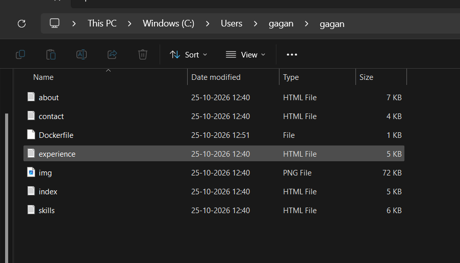
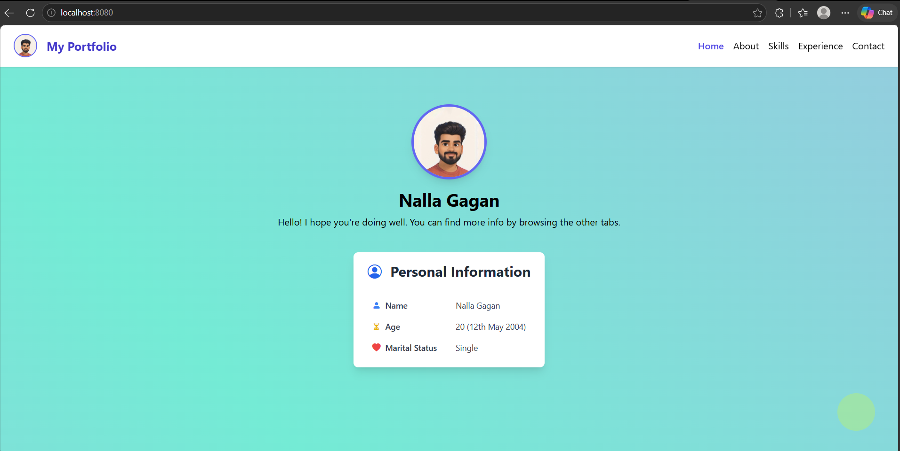
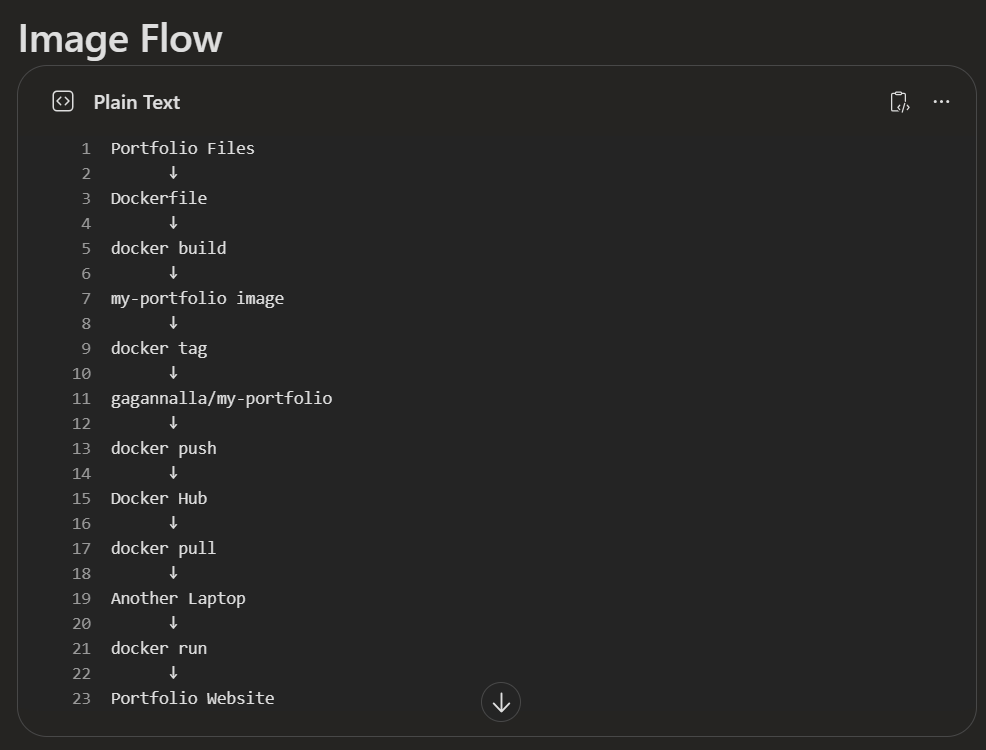
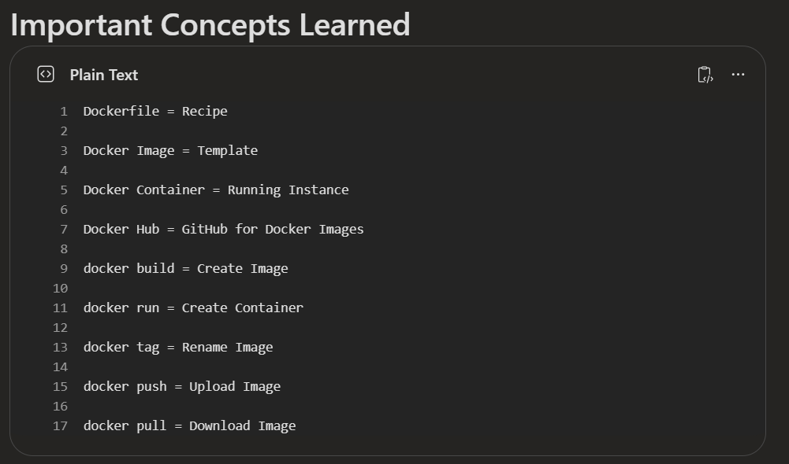

# Docker Push & Pull Lab

In this demo, we will deploy a simple portfolio website using Docker, publish the image to Docker Hub, and then pull and run it from another laptop.

# Prerequisites

✅ Install Docker Desktop

✅ Start Docker Desktop

✅ Verify Docker is running

docker --version

# Project Location

The Dockerfile and website files are stored in:

C:\Users\gagan\gagan

This is the location from where we will build our Docker image.

# Step 1: Create a Dockerfile

Create a file named:

Dockerfile

Add the following content:

FROM nginx:alpine

COPY . /usr/share/nginx/html/

EXPOSE 80

CMD ["nginx", "-g", "daemon off;"]

## Purpose

**FROM nginx:alpine**

Uses Nginx as the base image.

**COPY . /usr/share/nginx/html/**

Copies all website files into the Nginx web server directory.

**EXPOSE 80**

Exposes port 80 inside the container.

**CMD ["nginx", "-g", "daemon off;"]**

Starts the Nginx web server when the container starts.

# Step 2: Build the Docker Image

Navigate to the project folder:

cd C:\Users\gagan\gagan

Build the image:

docker build -t my-portfolio .

## Note:
If build comamd  files run the below in Powershell
dir (check if dockerfile is in .txt if yes run ren Dockerfile.txt Dockerfile to avoid .txt)

## Explanation

docker build = Create Docker image

-t = Tag the image

my-portfolio = Image name

. = Current directory

## Result

Dockerfile

↓

my-portfolio Image

Verify:

docker images

# Step 3: Test the Application Locally

Run the container:

docker run -d -p 8080:80 my-portfolio

## Explanation

-d = Detached mode

-p = Port mapping

8080 = Local machine port

80 = Container port

Check running containers:

docker ps

Open:

http://localhost:8080

# Step 4: Login to Docker Hub

Create an account:

https://hub.docker.com

Login:

docker login

# Step 5: Tag the Image

docker tag my-portfolio gagannalla/my-portfolio:latest

Verify:

docker images

# Step 6: Push the Image to Docker Hub

docker push gagannalla/my-portfolio:latest

# Step 7: Pull the Image on Another Laptop

docker pull gagannalla/my-portfolio:latest

Verify:

docker images

Run:

docker run -d -p 8080:80 gagannalla/my-portfolio:latest

Open:

http://localhost:8080

# Docker Workflow

# Key Concepts Learned

**Dockerfile** = Blueprint used to create images

**Image** = Template of an application

**Container** = Running instance of an image

**Docker Hub** = Online repository for Docker images

**docker build** = Creates an image

**docker run** = Creates a container

**docker tag** = Creates a new tag for an image

**docker push** = Uploads an image to Docker Hub

**docker pull** = Downloads an image from Docker Hub

# Conclusion

✅ Created a Dockerfile

✅ Built a Docker image

✅ Tested the application locally

✅ Tagged the image using Docker Hub username

✅ Pushed the image to Docker Hub

✅ Pulled the image on another laptop

✅ Successfully deployed the application using Docker

✅ Learned the complete Docker Build → Run → Tag → Push → Pull workflow

🚀 Congratulations! You have completed your first Docker Push & Pull Lab.